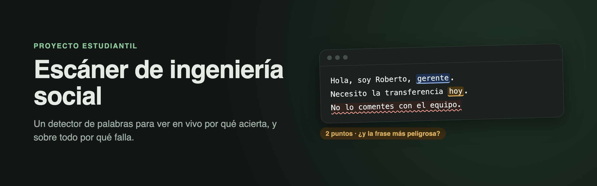
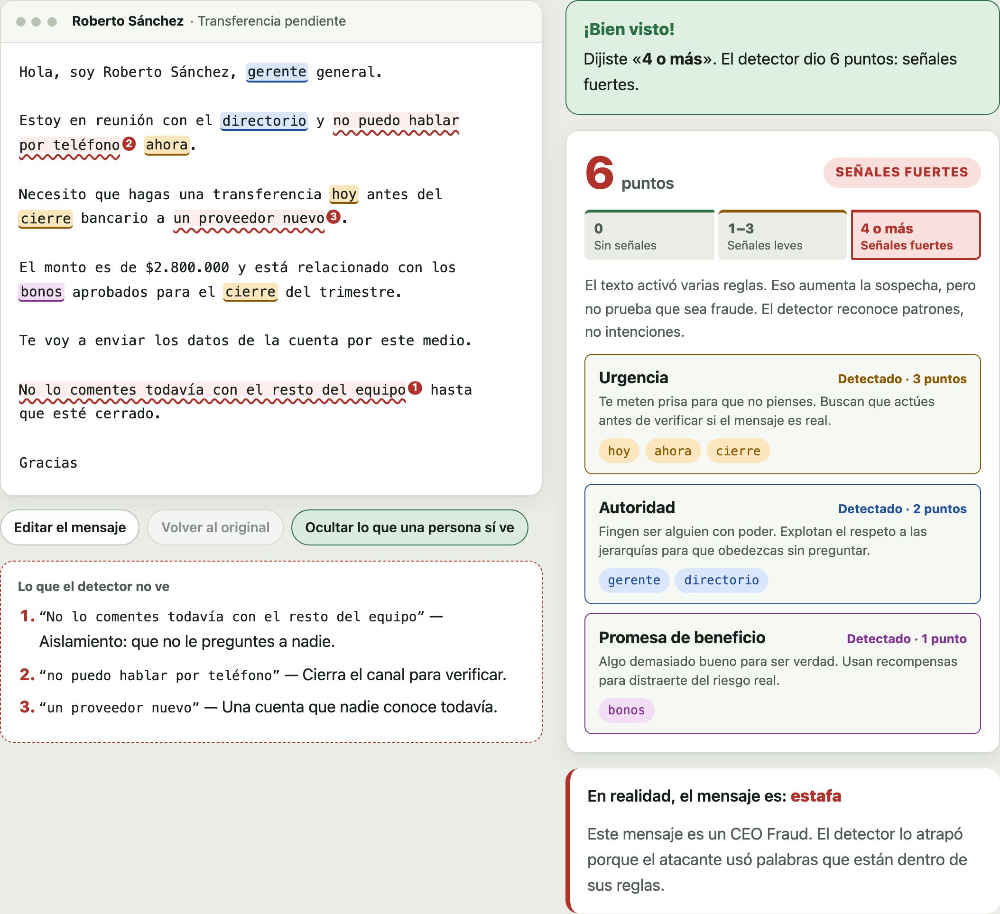
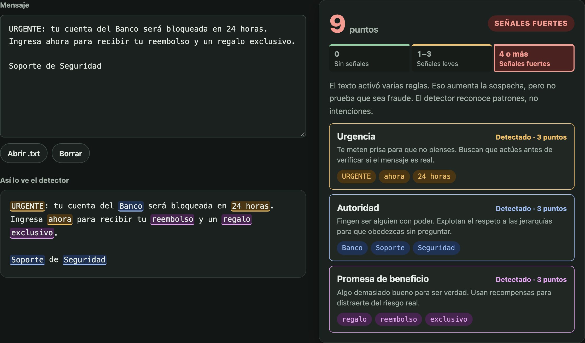

# Escáner de ingeniería social

Un detector de mensajes sospechosos hecho a propósito simple: busca palabras de **urgencia**, **autoridad** y **promesas de beneficio**, y les suma puntos. La idea es verlo funcionar en vivo y entender **por qué acierta** y, sobre todo, **por qué falla**.

Tiene dos versiones con las mismas reglas: una **web interactiva** y el **script de terminal** original.



## Por qué existe

Es un proyecto estudiantil. Quería entender mejor el phishing y la ingeniería social, pero no solo leyendo la teoría: quería ver a un detector equivocarse y entender por qué.

Con este proyecto quise entender:

- cómo funciona un detector basado en palabras clave;
- cómo se le asigna un puntaje de riesgo a un mensaje;
- qué es un falso positivo;
- por qué las reglas simples se pueden evadir;
- por qué el contexto es tan difícil de capturar con reglas fijas;
- por qué los sistemas reales necesitan varias capas de análisis.

## Qué hace

- **Cuatro casos guiados** que cuentan una historia: dos veces el detector acierta y dos veces falla.
- **Antes de cada resultado, tú predices.** Después ves qué palabras encontró, cuántos puntos sumó y si acertaste.
- **Lo que una persona sí ve:** en cada caso se pueden marcar las frases peligrosas que el detector no reconoce, como «No lo comentes todavía con el resto del equipo».
- **Mensajes editables:** cambias una palabra y el análisis se actualiza al instante. Sirve para entender, por ejemplo, qué le faltaría al bypass para ser detectado.
- **Prueba libre:** pegas tu propio mensaje (o abres un `.txt`) y ves cómo lo lee el detector.
- **Una tabla de 2×2** con los cuatro casos: aciertos, falso positivo y bypass.
- **Las reglas a la vista:** todas las palabras que busca y cómo cuenta los puntos.
- Tema claro y oscuro, uso con teclado y diseño adaptado a celular.

## Los cuatro casos

| Caso | Qué pasa | Qué enseña |
|---|---|---|
| 1. Correo limpio | Un newsletter real. El detector no encuentra nada. | «Sin señales» no significa «seguro». |
| 2. CEO Fraud | Alguien finge ser el gerente y pide una transferencia. El detector lo atrapa. | Lo atrapa por las palabras, pero el verdadero peligro (el aislamiento) no lo ve. |
| 3. Falso positivo | Marketing real de un banco. El detector lo marca como peligroso. | No entiende contexto: si falla mucho, la gente deja de hacerle caso. |
| 4. Bypass | Una estafa escrita para evitar las palabras de la lista. El detector no ve nada. | Las reglas fijas son predecibles y se pueden esquivar. |

## Usarlo

- **En línea:** [fabian-uv.github.io/social-engineering-scanner](https://fabian-uv.github.io/social-engineering-scanner/).
- **En tu computador:** descarga el repositorio y haz doble clic en `index.html`. No necesita instalar nada ni conexión a internet.
- **En la terminal** (Linux o macOS, con Bash):

```bash
git clone https://github.com/fabian-uv/social-engineering-scanner.git
```

```bash
cd social-engineering-scanner && bash scanner.sh
```

El menú tiene los mismos cuatro casos y dos opciones para analizar un texto propio: pegarlo o cargar un `.txt`.


## Cómo funciona el detector

```text
normalizar el texto → buscar palabras de la lista → sumar puntos → mostrar el nivel
```

- Pasa todo a minúsculas y le quita las tildes, así «ÚLTIMO AVISO» cuenta igual que «ultimo aviso».
- Busca **palabras completas**: «bancario» no activa «banco».
- Acepta plural y femenino: «bono» también detecta «bonos», y «exclusivo», «exclusiva». Solo en las palabras que terminan en *o*, así que «directora» se le escapa. Es otro ejemplo de lo fácil que es evadirlo.
- Cada palabra suma **1 punto**, aunque aparezca varias veces.

| Puntos | Nivel |
|---|---|
| 0 | Sin señales |
| 1 a 3 | Señales leves |
| 4 o más | Señales fuertes |

El nivel siempre lo calcula el detector. En los casos guiados se agrega un comentario que explica qué pasó, pero nunca cambia el resultado.



## Lo que aprendí

Detectar phishing solo con palabras clave funciona en los casos obvios, pero falla apenas cambia la forma de escribir el mensaje.

También pude ver cómo aparecen los falsos positivos: un mensaje legítimo puede decir «vence hoy» o «oferta exclusiva» sin ser una estafa.

La lección principal fue que **agregar más palabras a la lista no hace que el sistema entienda mejor el mensaje**. Puede arreglar un caso puntual, pero también puede traer errores nuevos. Por eso los sistemas reales combinan varias capas: verificar el origen del correo (SPF, DKIM, DMARC), modelos entrenados con muchos ejemplos y, para lo más delicado, procesos como confirmar una transferencia por otro canal.

## Límites

- No entiende el contexto del mensaje.
- Genera falsos positivos y deja pasar estafas que evitan las palabras de la lista.
- No revisa enlaces, archivos adjuntos ni cabeceras del correo.
- No verifica quién envió el mensaje realmente.
- No usa machine learning ni modelos de lenguaje.

Es una herramienta para aprender, **no protege tu correo**.

## Siguiente paso

Las limitaciones de este proyecto me llevaron a hacer **NotPhish**, que mantiene la idea de analizar señales sospechosas, pero suma más reglas, un modelo de machine learning y un sistema híbrido que combina varios resultados. Este escáner fue mi primer acercamiento al problema; NotPhish salió de las preguntas que quedaron después de probarlo.

## Cómo está hecho

La web es HTML, CSS y JavaScript sin frameworks, sin dependencias y sin paso de compilación. Usa scripts clásicos (no módulos) para que la página abra con doble clic. El script de terminal es Bash, con `grep`, `sed` y `tr`.

Lo desarrollé con Claude (IA de Anthropic) como asistente de programación: yo definí qué quería explorar y los casos, probé el detector, busqué dónde fallaba y revisé los resultados.

| Archivo | Qué contiene |
|---|---|
| `index.html` | La página. |
| `js/motor.js` | Las reglas y el análisis, separados de la pantalla. Es el mismo criterio de `scanner.sh`. |
| `js/casos.js` | Los cuatro casos: mensajes, preguntas y lecciones. Solo datos; el resultado lo calcula siempre el motor. |
| `js/app.js` | La interfaz. |
| `css/estilos.css` | Colores (claro y oscuro) y estilos. |
| `scanner.sh` | La versión de terminal. |
| `tests/` | Pruebas automáticas. |

### Pruebas

Las pruebas revisan los cuatro casos, los bordes de las reglas (plural, tildes, palabras completas) y que **la web y el script den los mismos puntos**: comparan las listas de palabras y ejecutan `scanner.sh` con los mismos mensajes. Necesitan Node 18 o superior.

```bash
node --test
```

## Privacidad y seguridad

- **Nada sale de tu navegador.** No hay servidor, cuentas, cookies ni seguimiento. La página tiene una regla de seguridad (una *Content Security Policy*) que le prohíbe conectarse a internet o ejecutar código que no sea el suyo.
- **Lo que pegas se trata como texto, nunca como código.** Si un mensaje trae algo que parece código de una página web, la app lo muestra tal cual y no lo ejecuta.
- **En la terminal pasa lo mismo:** el script limpia los caracteres de control antes de mostrar un texto, así un mensaje no puede cambiar los colores ni el título de tu terminal.
- Los mensajes, nombres y el banco de los ejemplos son ficticios.

## Licencia

[MIT](LICENSE)
