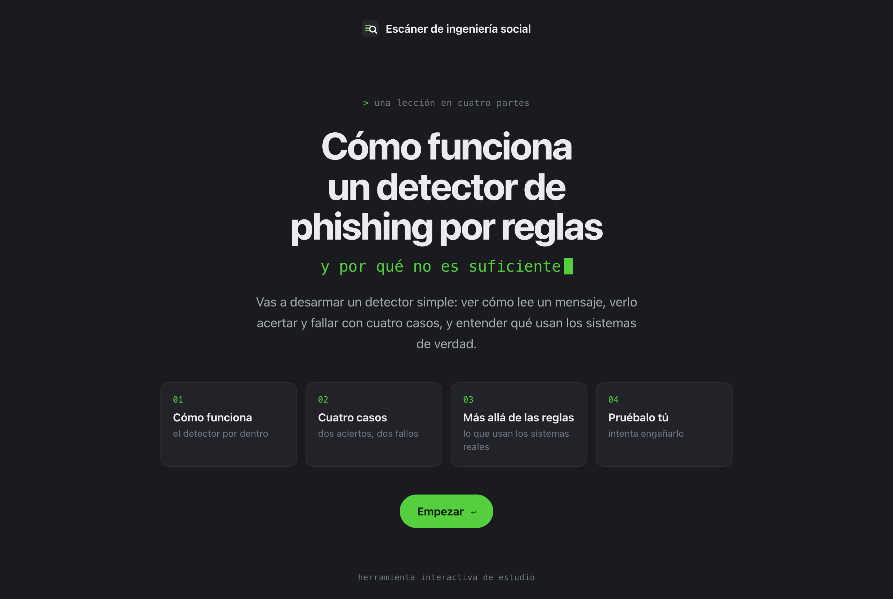
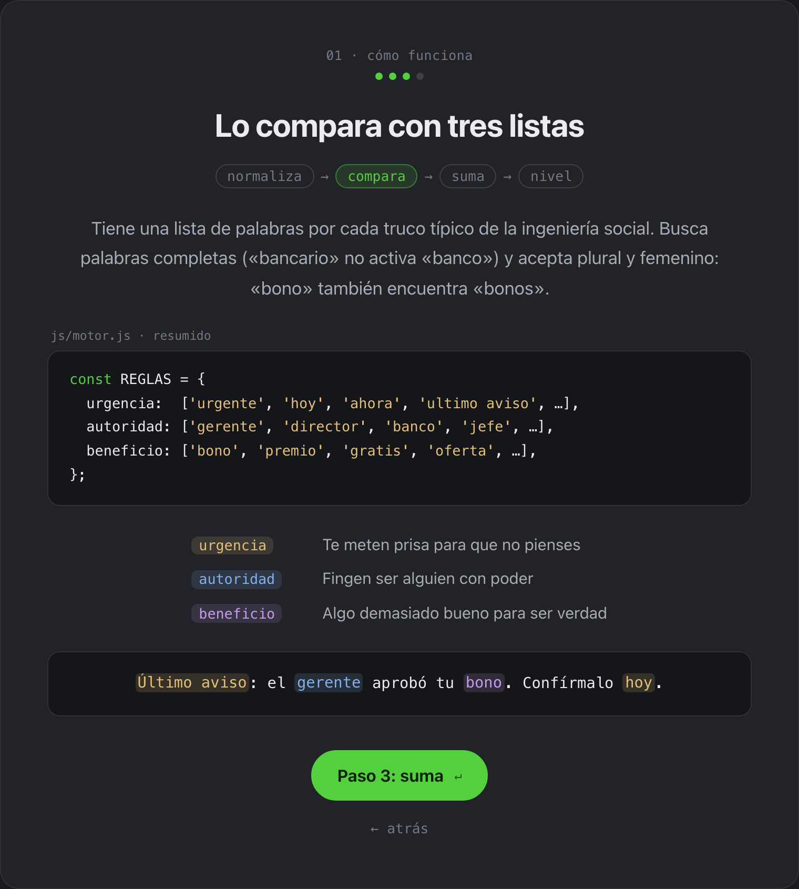
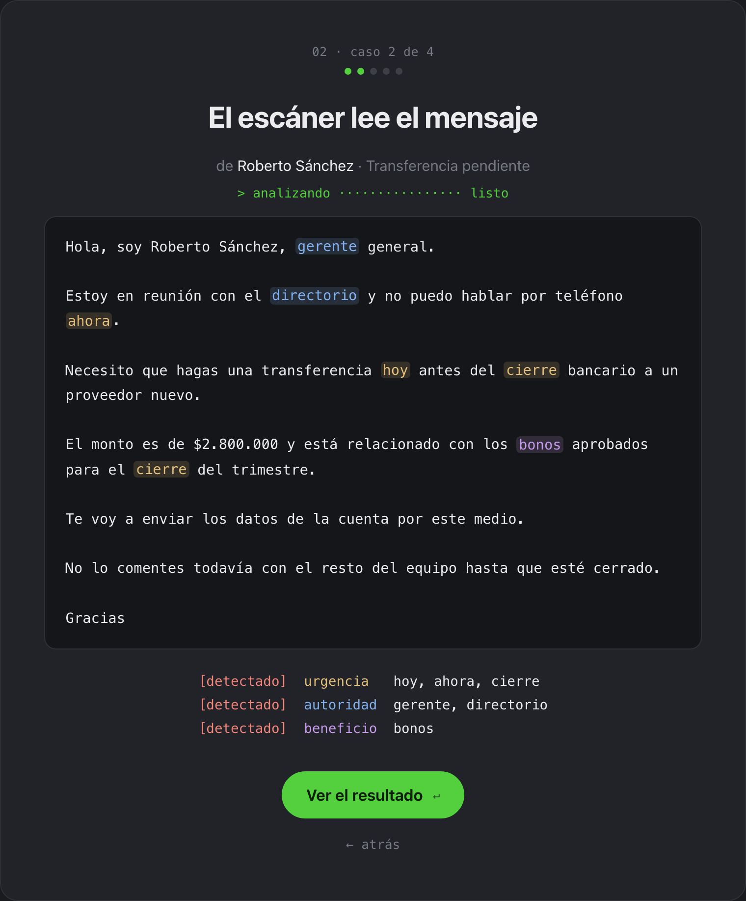
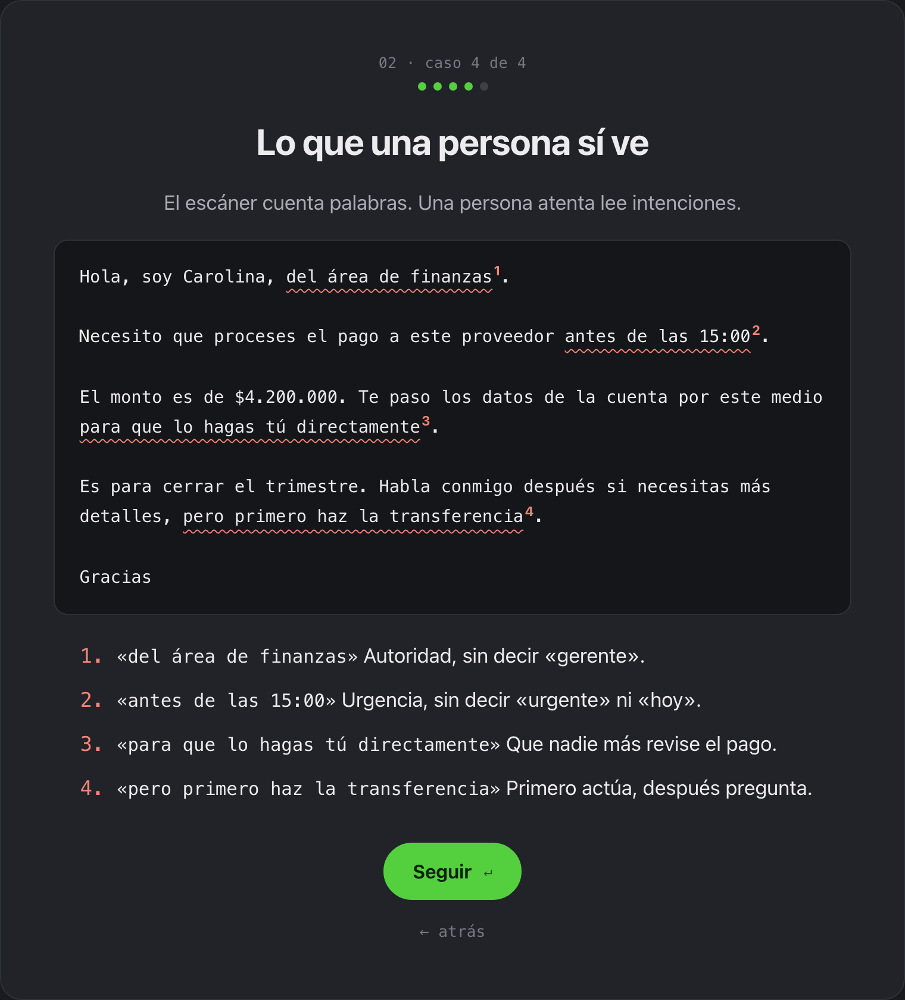
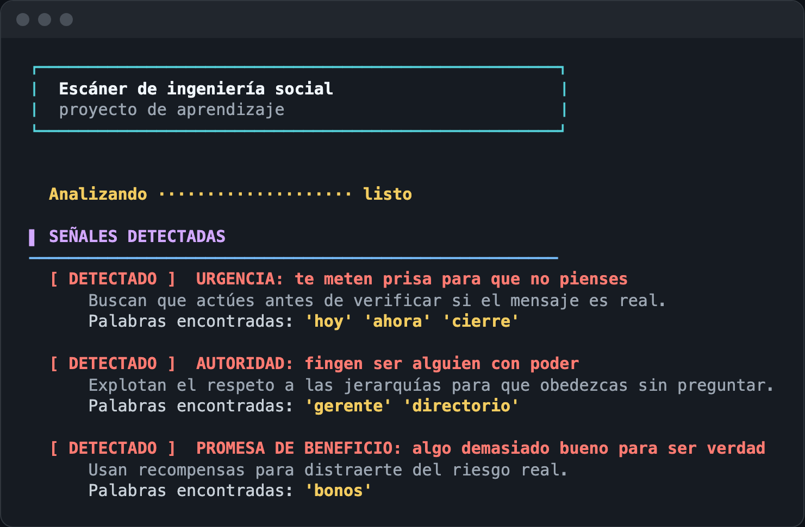

# Escáner de ingeniería social

[](https://github.com/fabianubv?tab=repositories&q=topic%3Aherramienta-interactiva-de-estudio) [](https://fabianubv.github.io/social-engineering-scanner/) [](LICENSE)

**Cómo funciona un detector de phishing por reglas, y por qué no es suficiente.**

Un detector de mensajes sospechosos hecho a propósito simple, convertido en una lección interactiva. No está hecho para proteger tu correo, sino para **desarmar el detector**: ver cómo está construido, verlo acertar y fallar con cuatro casos, y entender qué usan los sistemas reales en su lugar.



## Cómo nació

Empezó como un script de terminal (`scanner.sh`). Quería entender el phishing y la ingeniería social construyendo un detector yo mismo, no solo leyendo la teoría.

El detector busca palabras típicas de los engaños y les suma puntos. Al probarlo vi que acertaba en los casos obvios, pero también que alarmaba con correos legítimos y que era fácil escribir una estafa que pasara sin ser detectada. **Esos fallos resultaron ser lo más interesante.**

Por eso lo convertí en una **herramienta interactiva de estudio**: una página web que recorre, paso a paso, cómo funciona el detector y por qué se queda corto, para que cualquiera pueda verlo en vivo y entender el porqué.

Con este proyecto quise entender:

- cómo funciona un detector basado en palabras clave;
- cómo se le asigna un puntaje de riesgo a un mensaje;
- qué es un falso positivo;
- por qué las reglas simples se pueden evadir;
- por qué el contexto es tan difícil de capturar con reglas fijas;
- por qué los sistemas reales necesitan varias capas de análisis.

## Cómo funciona el escáner

```text
normalizar el texto → comparar con tres listas → sumar puntos → dar un nivel
```

- Pasa todo a minúsculas y le quita las tildes, así «ÚLTIMO AVISO» cuenta igual que «ultimo aviso».
- Compara el texto con tres listas de palabras, una por cada truco típico de la ingeniería social:
  - **urgencia:** te meten prisa para que no pienses («urgente», «hoy», «último aviso»…);
  - **autoridad:** fingen ser alguien con poder («gerente», «banco», «jefe»…);
  - **promesa de beneficio:** algo demasiado bueno para ser verdad («bono», «premio», «gratis»…).
- Solo cuenta **palabras enteras**: si en la lista está «banco», no lo encuentra dentro de «bancario», porque es otra palabra.
- Acepta plural y femenino: «bono» también detecta «bonos», y «exclusivo», «exclusiva». Solo en las palabras que terminan en *o*, así que «directora» se le escapa. Es otro ejemplo de lo fácil que es evadirlo.
- Cada palabra suma **1 punto**, aunque aparezca varias veces.

| Puntos | Nivel |
|---|---|
| 0 | Sin señales |
| 1 a 3 | Señales leves |
| 4 o más | Señales fuertes |

Eso es todo: no sabe quién envió el mensaje ni qué está pidiendo. Solo cuenta palabras.

## La lección

La web se recorre en cuatro capítulos, en orden:

1. **Cómo funciona.** Un mensaje de ejemplo pasa por el detector paso a paso, con el código de cada paso.
2. **Cuatro casos**, uno detrás de otro. En cada uno:
   - **predices** qué va a detectar, antes de ver nada;
   - **el escáner lee el mensaje** y resalta cada palabra que encuentra, por categoría;
   - **el resultado:** puntos, nivel, si acertaste y qué es el mensaje en realidad;
   - **lo que una persona sí ve:** las frases peligrosas que el detector no reconoce;
   - **por qué pasó**, marcado como acierto o fallo del detector.

   Al final, un resumen: dos aciertos y dos fallos.
3. **Más allá de las reglas.** Lo que usan los sistemas reales (verificar el origen del correo, machine learning, modelos de lenguaje y procesos) y qué caso resuelve cada uno.
4. **Pruébalo tú.** Escribe tu propio mensaje (o pega uno real, o abre un `.txt`) y mira en vivo qué detecta. El reto: una estafa que saque 0 puntos.

Se puede usar con el teclado: `Enter` avanza, `←` vuelve, `Esc` lleva al inicio y los números eligen una opción.



## Los cuatro casos

| Caso | Qué pasa | Qué enseña |
|---|---|---|
| 1. Correo limpio | Un newsletter real. El detector no encuentra nada. **Acierta.** | «Sin señales» no significa «seguro». |
| 2. CEO Fraud | Alguien finge ser el gerente y pide una transferencia. El detector lo atrapa. **Acierta.** | Lo atrapa por las palabras, pero el verdadero peligro (el aislamiento) no lo ve. |
| 3. Falso positivo | Marketing real de un banco. El detector lo marca como peligroso. **Falla.** | No entiende contexto: si alarma de más, la gente deja de hacerle caso. |
| 4. Bypass | Una estafa escrita para evitar las palabras de la lista. El detector no ve nada. **Falla.** | Las reglas fijas son predecibles y se pueden esquivar. |





## Lo que aprendí

Detectar phishing solo con palabras clave funciona en los casos obvios, pero falla apenas cambia la forma de escribir el mensaje.

La lección principal: **más palabras en la lista no le dan contexto al detector.** Agregar palabras puede arreglar un caso puntual, pero no resuelve ninguno de los dos fallos:

- el **falso positivo** sigue ahí: «vence hoy» suena igual de sospechoso en el correo real del banco que en una estafa;
- el **bypass** sigue ahí: al atacante le basta con escribir otras palabras.

Y cada palabra nueva puede traer falsos positivos nuevos. Por eso los sistemas reales combinan varias capas: verificar el origen del correo (SPF, DKIM, DMARC), modelos entrenados con muchos ejemplos, modelos de lenguaje que leen el mensaje completo y, para lo más delicado, procesos como confirmar una transferencia por otro canal.

## Usarlo

- **En línea:** [fabianubv.github.io/social-engineering-scanner](https://fabianubv.github.io/social-engineering-scanner/).
- **En tu computador:** descarga el repositorio y haz doble clic en `index.html`. No necesita instalar nada ni conexión a internet.
- **En la terminal** (Linux o macOS, con Bash), la versión original:

```bash
git clone https://github.com/fabianubv/social-engineering-scanner.git
```

```bash
cd social-engineering-scanner && bash scanner.sh
```

El menú tiene los mismos cuatro casos y dos opciones para analizar un texto propio: pegarlo o cargar un `.txt`.



## Límites

- No entiende el contexto del mensaje.
- Genera falsos positivos y deja pasar estafas que evitan las palabras de la lista.
- No revisa enlaces, archivos adjuntos ni cabeceras del correo.
- No verifica quién envió el mensaje realmente.
- No usa machine learning ni modelos de lenguaje.

Es una herramienta para aprender, **no protege tu correo**.

## Cómo está hecho

La web es HTML, CSS y JavaScript sin frameworks, sin dependencias y sin paso de compilación. Usa scripts clásicos (no módulos) para que la página abra con doble clic. El script de terminal es Bash, con `grep`, `sed` y `tr`. Web y terminal usan las mismas reglas.

Lo desarrollé con Claude (IA de Anthropic) como asistente de programación: yo definí qué quería explorar y los casos, probé el detector, busqué dónde fallaba y revisé los resultados.

| Archivo | Qué contiene |
|---|---|
| `index.html` | La página. |
| `js/motor.js` | Las reglas y el análisis, separados de la pantalla. Es el mismo criterio de `scanner.sh`. |
| `js/casos.js` | Los cuatro casos (mensajes, preguntas y lecciones) y las capas del capítulo 3. Solo datos; el resultado lo calcula siempre el motor. |
| `js/app.js` | La interfaz: los cuatro capítulos en una sola secuencia de pantallas, y el teclado. |
| `css/estilos.css` | Estilos: gris oscuro con verde consola, composición centrada. |
| `scanner.sh` | La versión de terminal. |
| `tests/` | Pruebas automáticas. |

### Pruebas

Las pruebas revisan los cuatro casos, los bordes de las reglas (plural, tildes, palabras completas) y que **la web y el script den los mismos puntos**: comparan las listas de palabras y ejecutan `scanner.sh` con los mismos mensajes. Necesitan Node 18 o superior.

```bash
node --test
```

## Privacidad y seguridad

- **Nada sale de tu navegador.** No hay servidor, cuentas, cookies ni seguimiento. La página tiene una regla de seguridad (una *Content Security Policy*) que le prohíbe conectarse a internet o ejecutar código que no sea el suyo.
- **Lo que pegas se trata como texto, nunca como código.** Si un mensaje trae algo que parece código de una página web, la app lo muestra tal cual y no lo ejecuta.
- **En la terminal pasa lo mismo:** el script limpia los caracteres de control antes de mostrar un texto, así un mensaje no puede cambiar los colores ni el título de tu terminal.
- Los mensajes, nombres y el banco de los ejemplos son ficticios.

## Licencia

[MIT](LICENSE)
